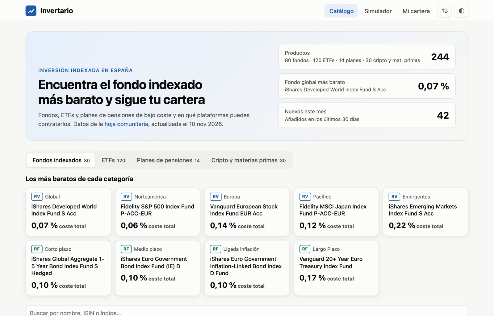
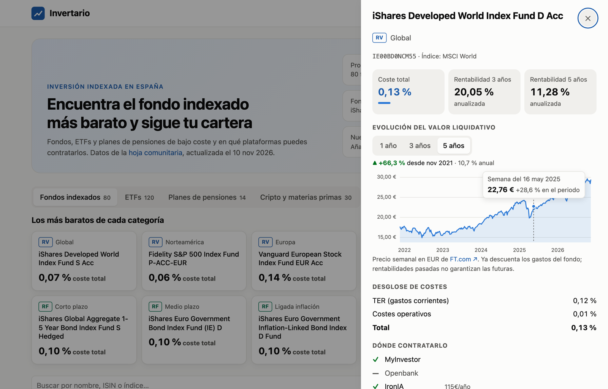
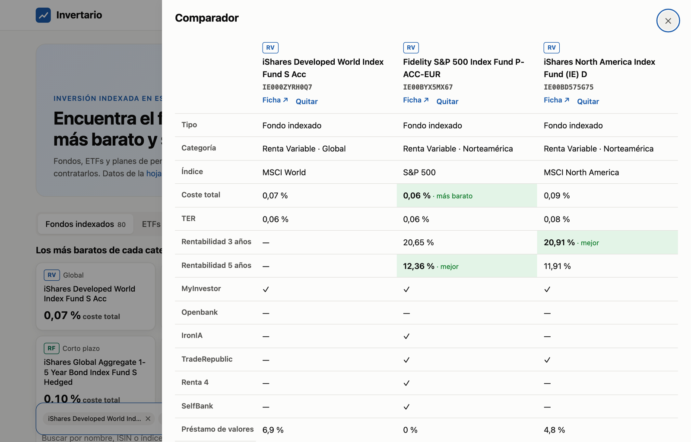
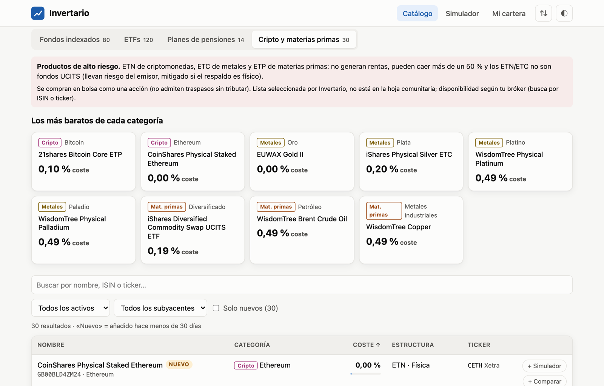
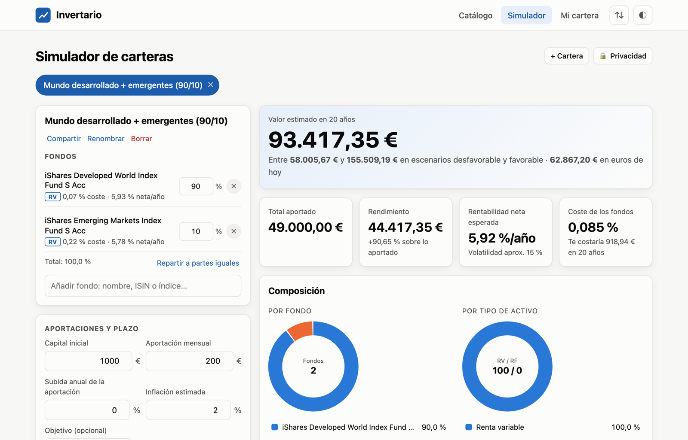
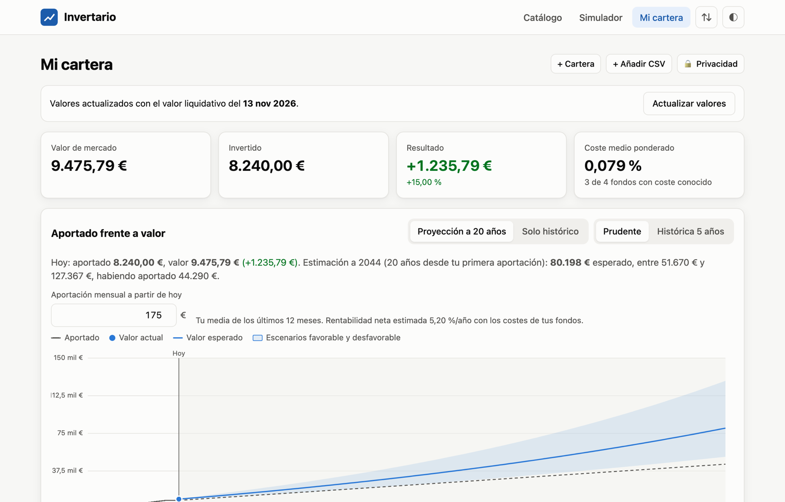
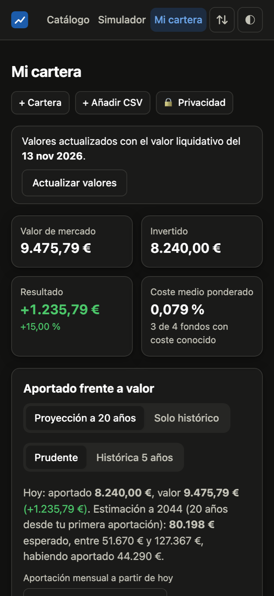

<div align="center">

# 📈 Invertario

**Encuentra el fondo indexado más barato, simula tu cartera y sigue la que ya tienes.**

Fondos indexados, ETFs, planes de pensiones y productos alternativos disponibles en España,
con sus costes reales y dónde contratarlos. Sin registro y sin que tus datos salgan del navegador.

[**invertario.vercel.app**](https://invertario.vercel.app) · Vite + React + TypeScript · Datos actualizados cada día

</div>



---

## Índice

- [Qué puedes hacer](#qué-puedes-hacer)
  - [Catálogo](#-catálogo)
  - [Ficha y comparador](#-ficha-y-comparador)
  - [Cripto y materias primas](#-cripto-y-materias-primas)
  - [Simulador](#-simulador)
  - [Mi cartera](#-mi-cartera)
- [Privacidad](#-privacidad)
- [Cómo funciona por dentro](#cómo-funciona-por-dentro)
- [Desarrollo](#desarrollo)
- [Despliegue](#despliegue)

---

## Qué puedes hacer

### 🔎 Catálogo

Todos los productos de la [hoja de cálculo mantenida por la comunidad](https://docs.google.com/spreadsheets/d/1qTBkH0K5zE-e5OXsUo6Prmo2QGmYNWf63Y-iLQqdBaA), en pestañas: **fondos indexados**, **ETFs**, **planes de pensiones** y **cripto y materias primas**.

- **Los más baratos de cada categoría** de un vistazo, arriba de todo.
- **Búsqueda** por nombre, ISIN, índice o ticker, y **filtros** por tipo de activo, región/plazo y plataforma.
- **Orden** por coste total o rentabilidad a 3 y 5 años.
- **Productos nuevos** marcados durante 30 días desde que aparecen en la hoja.
- **ISIN fuera del catálogo**: si buscas un ISIN que no está, el botón *«Buscar este ISIN fuera del catálogo»* crea una ficha **«No catalogado»** con su coste, categoría y domicilio. Puedes compararla y usarla en el simulador como cualquier otra. También funciona con **acciones** (p. ej. `US0378331005`, Apple), con su cotización en euros.

Los filtros viven en la URL, así que cualquier búsqueda se puede compartir con un enlace.

### 📋 Ficha y comparador

<table>
<tr>
<td width="50%"></td>
<td width="50%"></td>
</tr>
<tr>
<td><b>Ficha</b>: evolución del valor liquidativo o la cotización a 1, 3 y 5 años (semanal, de FT.com), desglose de costes (TER + costes operativos), plataformas donde contratarlo, préstamo de valores y otros productos que replican el mismo índice, del más barato al más caro.</td>
<td><b>Comparador</b>: hasta 3 productos lado a lado. Resalta el más barato y el de mejor rentabilidad, y muestra en qué plataformas está cada uno.</td>
</tr>
</table>

### 🪙 Cripto y materias primas



Una lista seleccionada de **ETN de bitcoin y ethereum**, **ETC de oro, plata, platino y paladio** y **ETF/ETC de materias primas y petróleo**. Para cada uno: coste, estructura (ETN, ETC o ETF UCITS), respaldo (físico o sintético), ticker y bolsa.

Se muestra un aviso de riesgo: no generan rentas, pueden caer más de un 50 %, no admiten traspasos sin tributar y los ETN/ETC tienen riesgo de emisor.

La pestaña de ETFs suma también **ETFs monetarios** (€STR) e **inmobiliarios** (REIT), que no están en la hoja comunitaria.

### 🧮 Simulador



Crea carteras simuladas desde cero, con una plantilla o con *«+ Simulador»* desde el catálogo, y proyecta cuánto podrían valer:

- Capital inicial, **aportación mensual** con subida anual, plazo, inflación y objetivo.
- **Costes reales de cada fondo** descontados de la rentabilidad.
- Hipótesis **prudente**, **histórica a 5 años** o **personalizada**, con escenarios favorable y desfavorable.
- Composición **por fondo** y **por tipo de activo** (renta variable, renta fija, materias primas, cripto).
- Tabla año a año, **exportación a CSV** y **enlace para compartir** la cartera.

### 💼 Mi cartera



Importa los CSV de **plusvalías y minusvalías** que descargas de tu bróker (uno por fondo, con el ISIN en el nombre del archivo) o la **exportación de transacciones de Trade Republic** (acciones, ETFs y fondos, con títulos, dividendos y ventas). Arrástralos a la página o usa *«+ Añadir CSV»*.

- **Resumen**: valor de mercado, invertido, resultado y coste medio ponderado.
- **Aportado frente a valor**: gráfico con tu historial y una proyección a 20 años.
- **Posiciones**: cada fondo con sus lotes, su tipo de activo, sus plataformas y una alternativa más barata si existe.
- **Valores al día**: el CSV es una foto del día en que lo descargaste. Cada fondo se revalora con su último valor liquidativo.
- **Varias carteras**: *«+ Cartera»* crea otra independiente, por ejemplo la de otra persona o la de otro bróker. Se gestionan con pestañas: cambiar, renombrar o borrar con la ✕.
- **Reimportar sin duplicar**: si subes a la vez *«fondo X.csv»* y *«fondo X 2.csv»*, se queda la versión más reciente.
- **Traspasos**: si las aportaciones de un fondo reaparecen en otro, se detecta el traspaso. El fondo de origen sale de los totales y una tarjeta estima cuánto has ganado o perdido respecto a no haber traspasado.

<div align="center">

<br><sub>Diseñada también para el móvil, con tema claro y oscuro.</sub>
</div>

---

## 🔒 Privacidad

> **Invertario no tiene cuentas ni base de datos.** Tus carteras, simulaciones y preferencias se guardan **solo en tu navegador** (`localStorage`).

- Para identificar un fondo y actualizar su valor se consulta **solo su ISIN** (y una fecha) a la función propia `/api/fund`, que lee datos públicos de FT.com u OpenFIGI. Nunca se envían importes, movimientos ni nombres de archivo.
- Desde **⇅ Tus datos** puedes exportar todo a un `.json`, importarlo en otro navegador (combinando o reemplazando) o borrarlo todo.

---

## Cómo funciona por dentro

### Datos y actualización diaria

`.github/workflows/sync-funds.yml` se ejecuta cada día a las 05:30 UTC (y a mano desde *Actions*):

1. `scripts/sync-funds.mjs` descarga como CSV las pestañas *Fondos*, *ETFs* y *Planes pensiones* de la hoja comunitaria y añade los productos curados de `scripts/alternatives.json`. Si un ISIN está en ambos sitios, gana la hoja.
2. Genera `src/data/funds.json`. Conserva `addedAt` de los productos conocidos y pone la fecha de hoy a los nuevos. «Nuevo» dura 30 días (`NEW_DAYS` en `src/data.ts`).
3. Si hay cambios, hace commit y push, y Vercel redespliega solo.

### Productos curados

`scripts/alternatives.json` contiene ISIN, coste, estructura, respaldo, ticker y bolsa, verificados en justETF:

- Con tipo `alt`: cripto, metales y materias primas.
- Con `"type": "etf"` y `curated: true`: ETFs monetarios e inmobiliarios.

Estos productos no tienen datos de plataformas.

El simulador usa estas hipótesis propias para ellos:

| Producto | Rentabilidad anual | Volatilidad |
|---|---|---|
| Cripto | 5 % | 70 % |
| Metales | 4 % | 16 % |
| Materias primas | 3 % | 20 % |

### API `/api/fund`

Función serverless en `api/fund.ts`:

| Petición | Respuesta |
|---|---|
| `GET /api/fund?isin=XX…` | Nombre, categoría, tipo de activo, gastos corrientes y domicilio (FT.com; si no lo encuentra, OpenFIGI). Los ETF y ETC se buscan por su cotización en bolsa, preferiblemente en euros. |
| `GET /api/fund?isin=XX…&since=AAAA-MM-DD` | Valor liquidativo actual y el del día indicado o anterior. |
| `GET /api/fund?isin=XX…&history=5y` | Cierre semanal de los últimos años, para el gráfico de la ficha. |

Las **acciones** se reconocen con OpenFIGI (tipo de valor) y su cotización se toma de FT.com, priorizando Xetra y las bolsas de la zona euro. La búsqueda de FT es de texto libre, así que un ETF solo se acepta si su ficha muestra el ISIN y una acción solo si el nombre coincide con el de OpenFIGI.

La revaloración de Mi cartera es:

```
valor hoy = valor del CSV × VL actual / VL del día anterior a la importación
```

En la exportación de Trade Republic se conocen los títulos, así que `valor = títulos × cotización`; las ventas descuentan los lotes más antiguos (FIFO) y las criptomonedas compradas directamente se omiten. Del archivo solo se leen operaciones y dividendos: transferencias, pagos, nombres e IBAN se ignoran y no se guardan.

Solo se aplica con precios en euros. Si un producto solo tiene precio en otra moneda, se mantiene el valor del CSV para no mezclar el efecto del tipo de cambio.

### Traspasos

Un fondo cuyas aportaciones (fecha fiscal e importe) aparecen todas en otro fondo exportado después se considera traspasado.

La tarjeta compara dos valores:
- lo que valen hoy esos lotes en el fondo nuevo;
- lo que valdrían si siguieran en el de origen.

Es una **estimación**: los CSV no incluyen participaciones ni el valor liquidativo con el que se valoraron, así que la cifra puede desviarse unos euros. El dato exacto está en las órdenes del traspaso del bróker.

### Claves de almacenamiento

| Clave | Contenido |
|---|---|
| `invertario.portfolios.v1` | Carteras importadas (migra la antigua `invertario.portfolio.v1`) |
| `invertario.external.v1` | Productos buscados fuera del catálogo |
| `invertario.sims.v1` | Carteras simuladas |
| `invertario.theme` | Tema claro u oscuro |

Todo entra en la copia de seguridad de *Tus datos*.

---

## Desarrollo

```bash
npm install
npm run dev     # http://localhost:5173
npm run sync    # sincroniza los datos a mano
npm run build
```

Las capturas de este README están en `docs/screenshots/` y se hicieron con **datos inventados**.

## Despliegue

Importa el repositorio en Vercel. Detecta Vite solo (build `npm run build`, salida `dist`) y no requiere variables de entorno.

Para que el workflow pueda hacer push, en GitHub ve a *Settings → Actions → General → Workflow permissions* y activa **Read and write permissions**.
